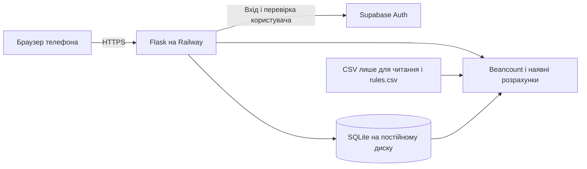

# 14. Архітектура реалізації спільного трекера

Дата: 22.10.2026. Погоджені користувачкою вимоги: **Supabase Auth, mobile-first, дешевий/безкоштовний хостинг із HTTPS**. Конкретна схема нижче — технічне рішення для реалізації. Цей крок змінює документацію; сервера, акаунтів провайдерів і конфігурації деплою в коді ще немає.

## Склад системи

- **Інтерфейс:** HTML/Jinja2, CSS і невеликий JS; повторно використовуємо адаптивні блоки report.py. Окремий React/Next.js-застосунок не потрібний для поточного обсягу.
- **Сервер:** Flask, Python 3.12+, Beancount 3, beanquery. Фінансову логіку й Decimal зберігаємо; існуючий імпорт розширюємо на Марка.
- **Вхід:** Supabase Auth. Хеші паролів, перевірку пароля й випуск токенів делегуємо провайдеру; локальної бази паролів не створюємо.
- **Дані:** SQLite для готівки, часток, погашень, налаштувань і серверних сесій; CSV — банківські факти, rules.csv — категоризація, журнал Beancount — відтворюваний результат. Supabase Auth не вимагає переносити фінансові дані до Supabase Postgres.
- **Публікація:** один Python-сервіс Railway і один persistent volume. Постійний диск зберігає дані між деплоями; [офіційний опис volumes](https://docs.railway.com/volumes).

## Supabase Auth та доступ до даних

1. Два попередньо створені акаунти, публічна реєстрація вимкнена. Незмінні UUID Supabase зіставляємо з Олею/Марком у серверній таблиці доступу; email або owner_id з форми не є доказом права.
2. Вхід email/пароль виконує сервер через офіційний Python SDK Supabase. Пароль використовується лише для запиту входу по HTTPS, не зберігається й не журналюється.
3. Браузеру видаємо випадковий ідентифікатор серверної сесії в cookie `Secure`, `HttpOnly`, `SameSite=Lax`; токени Supabase зберігаємо лише на сервері. У cookie немає пароля чи refresh token. Це серверний потік входу, без клієнтського Supabase SDK.
4. Для захищених запитів сервер отримує підтвердженого користувача через `get_user(access_token)`; простого декодування JWT або довіри до user з cookie недостатньо. [Документація get_user](https://supabase.com/docs/reference/python/auth-getuser).
5. Передбачаємо закінчення строку токена, оновлення з блокуванням паралельного refresh, вихід і видалення локальної сесії, а також відмову в доступі при помилці перевірки. SDK-клієнт із користувацьким станом не розділяємо між різними людьми.
6. Після автентифікації **власний сервер** перевіряє право на кожну вибірку/дію: свої особисті операції та дозволені спільні дані. Supabase Auth сам не фільтрує SQLite; політики RLS Supabase не захищають цю локальну БД. Якщо згодом переносимо дані до Postgres, додаємо й перевіряємо RLS окремо.
7. Записи захищаємо CSRF, вхід — обмеженням частоти спроб; приватні відповіді — `Cache-Control: private, no-store`. Fava, сирі CSV, журнал, SQLite та глобальний report.html не виставляємо публічними адресами.

Для двох акаунтів мінімальне демо не залежить від email magic links: початкові акаунти налаштовує адміністратор у Supabase Dashboard. Автоматичне поштове відновлення не обіцяємо без налаштованого SMTP: стандартна пошта має обмеження адресатів і частоти. [Обмеження Supabase SMTP](https://supabase.com/docs/guides/auth/auth-smtp). Для постійної експлуатації налаштування SMTP/відновлення треба оцінити окремо.

## Mobile-first як критерій готовності

- Базова верстка для 320–430 CSS px, ширші екрани — через розширення стилів. На ширинах 320/375/390/430/768/1280 немає горизонтального прокручування всієї сторінки; довгі описи переносяться, таблиці на телефоні стають картками або мають локальне прокручування.
- Поля, підписи, помилки й основні кнопки доступні без hover; цільова зона натискання — щонайменше 44×44 CSS px. Форма готівки має типову дату, зручну десяткову клавіатуру, перевірку суми й захист повторного надсилання.
- Окремо перевіряємо вхід/вихід, клавіатуру телефона, звіт, перемикач місяця та готівку в Safari на iOS і Chrome на Android. За відсутності реального пристрою фіксуємо межу перевірки емуляцією, а не називаємо її тестом телефона.
- Чужих даних немає у відповіді сервера, навіть якщо вони не показані в інтерфейсі. Наявний CSS повторно використовуємо, але повну адаптивність не вважаємо вже підтвердженою.

## Конфігурація майбутнього деплою

В реалізації готуємо `Dockerfile`, `.dockerignore`, `.env.example`, модуль `wsgi.py` та інструкцію Railway. Поки ці файли **не створені**: поточне завдання лишається архітектурним. Пакети `supabase` і production WSGI-сервер `gunicorn` ще не встановлені; їх версії й lock-файл оформлюємо на етапі реалізації за правилом дозволу на нові пакети.

| Параметр | Заплановане значення |
|---|---|
| Збірка | Dockerfile, Python 3.12+, залежності через uv і зафіксований uv.lock |
| Запуск | `sh -c 'exec uv run --no-sync gunicorn --bind 0.0.0.0:$PORT --workers 1 --threads 1 wsgi:app'` |
| Масштаб | 1 replica, 1 worker; узгоджене блокування запису/перебудови також для імпорту оператором |
| Постійний диск | Volume у `/app/storage`; не перекривати ним вихідний код і не монтувати в data/ |
| Runtime-шляхи | `/app/storage/tracker.sqlite3`, `/app/storage/generated/`, `/app/storage/input/` |
| Вхідні CSV | Підготовлені оператором штучні виписки; застосунок тільки читає input/; локальну data/ не змінюємо |
| rules.csv | Початковий файл у git; якщо редактор №21 увімкнений — робочий rules.csv на volume, перевірені зміни й резервування, без другого незалежного набору правил |
| Healthcheck | `/healthz`: лише стан процесу, без даних користувачів; готовність Auth перевіряється окремим приймальним сценарієм |
| Домен і TLS | Домен Railway, автоматичний HTTPS; свій домен необов’язковий |
| Секрети | Змінні Railway; у git лише заглушки в майбутньому .env.example |
| Демо | Окреме оточення, лише штучні дані, без увімкнення платного плану |

Назви конфігурації застосунку: `APP_BASE_URL`, `APP_SECRET_KEY`, `SUPABASE_URL`, `SUPABASE_PUBLISHABLE_KEY`, `STORAGE_DIR`, `IMPORT_INPUT_DIR`, `RULES_PATH`, `DATABASE_PATH`, `LEDGER_OUTPUT_DIR`. `PORT` надає хостинг. Права задаються серверною таблицею UUID/ролей, а не змінними з паролями. Ключ `service_role`/secret key не потрібний для звичайного входу; не додаємо його до браузера чи прикладів. Точний формат env буде реалізований разом із сервером, а не вже підтримується поточним кодом.

Volume доступний лише під час запуску, а не build/pre-deploy: створення схеми й початкових каталогів виконуємо під runtime-блокуванням перед стартом сервера. Схему не стираємо при кожному деплої. Перевіряємо збереження готівки після перезапуску та відновлення резервної копії SQLite/правил. [Доступність volume](https://docs.railway.com/volumes).

Налаштування спочатку задаємо в Railway Dashboard та документуємо поруч із Dockerfile. Не плануємо старий railway.toml для нового сервісу: документація позначає Config as Code застарілим; варіант для подальшої автоматизації — актуальний Railway Infrastructure as Code. [Офіційний статус конфігурації](https://docs.railway.com/config-as-code). Деплой ще не перевірений, команда запуску — проєктний контракт для майбутніх модулів.

## Хостинг і бюджет: джерела перевірені 22.10.2026

| Варіант | Перевірені умови | Рішення |
|---|---|---|
| Supabase Auth Free | $0, 50 000 активних користувачів на місяць; проєкт можуть призупинити після тижня неактивності | Використовуємо; перед показом демо перевіряємо доступність. [Тариф](https://supabase.com/pricing) |
| Railway Free/Trial | Free: $1 ресурсу на місяць, 0,5 GB volume; trial: $5 кредиту на 30 днів | Для безкоштовного демо після вимірювання ресурсу; це не обіцянка безкоштовної безперервної роботи. [Тариф](https://railway.com/pricing) |
| Railway Hobby | Мінімум $5/місяць включає $5 використання; перевищення оплачується за ресурсами | Дешевий розрахунковий варіант постійної роботи, без фактичного підключення. [Тариф](https://railway.com/pricing) |
| Домен/HTTPS | Домен Railway й автоматичний безкоштовний TLS | Без купівлі домену. [Мережа й HTTPS](https://docs.railway.com/networking/public-networking) |
| Vercel із локальною SQLite | Файлова система функцій read-only, запис лише в тимчасовий /tmp | Для цієї схеми не обираємо. Варіант із Vercel вимагав би окремої постійної БД й іншої інтеграції. [Обмеження runtime](https://vercel.com/docs/functions/runtimes) |

Для Hobby за незмінних тарифів місячна сума за базовий план і ресурс U: **5 + max(U−5, 0) = max(5, U)**, а не 5+U. Робоче бюджетне припущення: U≤$10/місяць → до **$120/рік + $30 резерву = $150**, без платного AI, SMTP і власного домену. Це планова межа, не виміряний рахунок. Ставимо Compute hard limit $10 і сповіщення раніше; враховуємо, що після ліміту сервіс зупиниться. Railway Agent не використовуємо й не зараховуємо його окремий ліміт до ліміту хостингу. [Керування витратами](https://docs.railway.com/pricing/cost-control).

Для практичного демо зберігається умова **$0 власних витрат**. Якщо безкоштовного ресурсу не вистачить на потрібний строк, спочатку перевіряємо режим сну/споживання або змінюємо безкоштовне розміщення; платний план не вмикаємо автоматично. Supabase Pro від $25/місяць сам по собі дає $300/рік і в бюджет $200 не входить.

## Що змінюється в оцінках і порядку робіт

Власні парольні хеші у фічі №12 замінені Supabase Auth. Серверні права, сесії, CSRF, обробка токенів і тести залишаються. [Оновлення 15](15-estimate-update.md) деталізує нову планову оцінку: **№12 — 21 год**, **№17 — 10 год**, включно з manifest/іконками/ярликом без офлайн-запису. Must тепер **98,5 / 131,33 год** без/із резервом. Це інженерна оцінка, не виміряна швидкість; автоматичної економії від готового Auth не приписуємо. Міграції всього обліку до Postgres немає.

Черга: модель власності/зберігання → обидва CSV й фінансові правила → локальний Supabase-вхід із двома користувачами → mobile-first звіт і готівка → конфігурація контейнера/диска → безкоштовний HTTPS-деплой → приймальні перевірки. При реалізації дозволи на дані застосовуємо до кожного нового маршруту одразу.

Готовність доводять: заборона доступу без входу й до чужих ID/експорту; ізольовані сесії двох людей; коректні refresh/вихід; робота на телефоні; збереження готівки після повторного імпорту й деплою; контрольні суми обох банків та чистий bean-check після змін обліку. Наявність цього плану не є проходженням цих перевірок.
